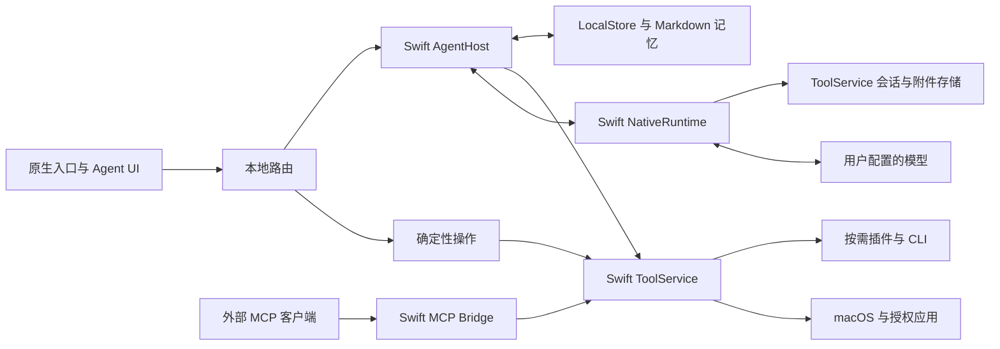

# Asky 产品框架与架构大纲

更新日期：2026 年 11 月 14 日。Agent 已迁移为 Swift 原生运行时；产品流程见 [PRD](PRD.md)，检查范围见 [迁移验证](validation/2026-11-14-native-agent.md)。

Asky 使用 SwiftUI / AppKit 原生效率入口，确定性功能不依赖模型。主应用拥有系统授权、工具执行、数据与资源；Agent 按明确请求运行。安装包不再包含 Pi SDK、Node 或 npm 依赖。

| 模块 | 职责与边界 |
| --- | --- |
| Native Shell | SwiftUI / AppKit、窗口、菜单栏、快捷键、焦点与原生确认；不持有全部历史 |
| Intent Router / Search | 本地关键词、表达式、显式命令、有限批次搜索与查询取消；普通输入不调用模型 |
| Direct Actions | 应用、URL、计算、单位、汇率、终端与 Shortcuts，不依赖 Agent |
| AgentHost / NativeRuntime | 按需任务生命周期、模型流式请求、工具循环、上下文压缩、会话恢复及 UI 事件；无模型辅助进程 |
| ToolService | 所有系统读写的统一入口，管理参数、授权、确认、去重、执行、回读和可信插件执行 |
| LocalStore / Memory | SQLite 产品历史、执行记录与计划；Markdown 授权记忆；Keychain 保存密钥 |
| Context Scheduler | 本地事件、冲突、路线与提醒计划；默认不后台启动模型 |
| MCP Bridge | 独立 Swift stdio 进程，经仅属主 Unix socket 连接应用；不独立访问系统数据 |
| Plugin Host | ToolService 按调用启动 API v2 可执行文件；旧 JS 插件使用用户本机 Node，均非沙箱 |

AgentHost 与 NativeRuntime 沿用 JSONL v2 事件结构，但在进程内传递。主应用仍是系统授权和确认主体；模型无法自行批准操作。插件与外部 MCP 也不得绕过 ToolService。

原生会话快照是当前请求工具循环的权威；跨轮持续上下文从 SQLite 保留的历史按需组装，SQLite 同时为分页 UI / 检索投影，系统操作以原生执行结果和回读为准。迁移旧 Pi 日志只恢复历史，不重放写操作。图片按引用保存，历史和设置不触发模型请求。

运行时只在明确 AI 提交时创建，无待处理任务或确认后默认空闲 60 秒销毁；不同会话独立，每会话同时只允许一个任务。取消不回滚已完成操作，未知写入结果标为待核实。插件进程与 CLI 只属于当次调用，不自动终止外部应用拥有的 Agent。

本地规则、现有通知和 MCP 不因 AI 关闭而停止；模型候选默认排队到下一次授权 AI 使用。性能要分别记录主应用、模型请求和插件进程，不能仅按语言宣称更快或低内存。

更多规则见 [Agent Runtime](agent-runtime.md)、[插件](plugins.md)、[原生工具与 MCP](native-tools-and-mcp.md)、[数据与记忆](data-and-memory.md)、[资源生命周期](resource-lifecycle.md) 和 [设计系统](design-system.md)。
